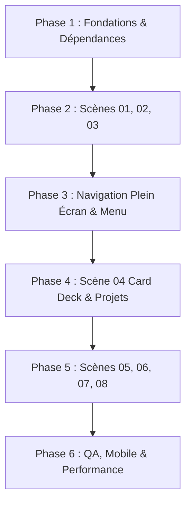

# 🎬 NAHLI.DEV — Feuille de Route de Refonte Cinématographique & Scrollytelling Immersif

> **Vision** : Transformer `nahli.dev` en un portfolio d'ingénieur d'exception digne des récompenses internationales (*Awwwards Site of the Day / FWA*), alliant **scrollytelling cinématographique continu**, typographie éditoriale géante, animations de scroll synchronisées et authenticité technique rigoureuse, sans compromettre les acquis (CMS Supabase, bilinguisme FR/EN, sécurité, SEO et performance).

---

## 📑 Sommaire

1. [Principes Directeurs & Contraintes Non Négociables](#1-principes-directeurs--contraintes-non-négociables)
2. [Design Tokens & Système Visuel](#2-design-tokens--système-visuel)
3. [Architecture Technique & Stack d'Animation](#3-architecture-technique--stack-danimation)
4. [Inventaire & Checklist des Médias](#4-inventaire--checklist-des-médias)
5. [Spécifications Détaillées des 8 Scènes](#5-spécifications-détaillées-des-8-scènes)
6. [Système de Navigation Plein Écran & Transitions](#6-système-de-navigation-plein-écran--transitions)
7. [Plan d'Exécution Pas-à-Pas (6 Phases / 25 Étapes Atomiques)](#7-plan-dexécution-pas-à-pas-6-phases--25-étapes-atomiques)
8. [Matrice d'Assurance Qualité, Accessibilité & Performance](#8-matrice-dassurance-qualité-accessibilité--performance)
9. [Gestion des Risques & Plan de Rollback](#9-gestion-des-risques--plan-de-rollback)

---

## 1. Principes Directeurs & Contraintes Non Négociables

### A. Continuité Narrative ("Single Continuous Canvas")
- Pas de succession de blocs séparés ou de bento grids génériques.
- Chaque scène prépare visuellement l'arrivée de la suivante via des techniques de **pinning**, de **découpe (clip-path)**, de **zoom progressif (scrub)** et d'**empilement de cartes (stack deck)**.

### B. Zéro Falsification & Crédibilité d'Ingénieur
- Préserver l'identité d'élève ingénieur en génie informatique (Cybersécurité, Intelligence Artificielle, Software Engineering).
- Ne présenter que des projets réels (*Smart Network Mapper*, *Portfolify*, *Agrishift AI*, etc.), de véritables captures d'écran et des données documentées.

### C. Préservation de l'Écosystème Existant
- **CMS Supabase & Back-Office Admin** : Conservation totale du dashboard `/admin`, des mutations sécurisées et de la gestion des médias.
- **Bilinguisme (i18n)** : Toutes les scènes, menus et transitions doivent être traduits en français (`/fr`) et en anglais (`/en`).
- **Formulaire de Contact Sécurisé** : Conservation du rate-limiting HMAC, du honeypot et du challenge temporel.
- **Assistant IA (Groq)** : Préservation du chatbot contextuel `ChatWidget`.

---

## 2. Design Tokens & Système Visuel

### A. Palette Chromatique
```css
:root {
  --bg-main: #101015;          /* Fond principal cinématographique */
  --bg-surface: #17161e;       /* Cartes et éléments surélevés */
  --bg-secondary: #211b2a;     /* Accentuation de profondeur */
  --accent-purple: #9a71ff;    /* Couleur d'énergie et de focus */
  --accent-purple-glow: rgba(154, 113, 255, 0.25);
  --text-primary: #f3f1f7;     /* Typographie principale contrastée */
  --text-muted: #797681;       /* Éléments discrets et métadonnées */
  --border-subtle: rgba(243, 241, 247, 0.08);
}
```

### B. Typographie Éditoriale
- **Titres & Display** : `Space Grotesk` ou `Geist` en graisses bold/black avec tracking négatif (`tracking-tighter`), échelle fluide (`clamp(2.5rem, 8vw, 9rem)`).
- **Corps de texte & UI** : `Inter` pour une lisibilité parfaite (15px à 18px).
- **Accents & Code** : `JetBrains Mono` pour les étiquettes de métadonnées, numéros de chapitre (`// 01`) et tags techniques.

---

## 3. Architecture Technique & Stack d'Animation

### A. Dépendances Clés
- **Lenis (`lenis: ^1.3.25`)** : Défilement fluide inertiel (déjà présent dans le projet).
- **GSAP (`gsap`) & `@gsap/react`** : Moteur de timeline et hooks pour React 19 / Next.js 15.
- **ScrollTrigger** : Synchronisation avec le scroll (`pin`, `scrub`, `start`, `end`).

### B. Boucle d'Animation Unique (Clock Synchronization)
Pour éliminer tout conflit ou décalage entre le défilement fluide et le calcul des positions GSAP :
```typescript
// Synchronisation obligatoire dans SmoothScrollProvider.tsx
lenis.on("scroll", ScrollTrigger.update);
gsap.ticker.add((time) => {
  lenis.raf(time * 1000);
});
gsap.ticker.lagSmoothing(0);
```

### C. Arborescence Cible des Composants
```text
src/
├── components/
│   ├── cinematic/
│   │   ├── CinematicCanvas.tsx       # Orchestrateur global de la page d'accueil
│   │   ├── HeroScene.tsx             # Scène 01 : Nom géant, portrait, zoom d'ouverture
│   │   ├── ManifestoScene.tsx        # Scène 02 : Pinned typography "I BUILD. I SECURE. I INNOVATE."
│   │   ├── UniverseScene.tsx         # Scène 03 : Cyber / IA / Software (Transitions 3D / Parallax)
│   │   ├── SelectedWorkScene.tsx     # Scène 04 : Deck de cartes empilées (Stack Deck)
│   │   ├── AboutScene.tsx            # Scène 05 : Portrait sticky & découpe masque
│   │   ├── JourneyScene.tsx          # Scène 06 : Timeline grand format
│   │   ├── ExpertiseScene.tsx        # Scène 07 : Typographie éditoriale en ruban
│   │   └── ContactScene.tsx          # Scène 08 : Écran final & intégration API contact
│   ├── motion/
│   │   ├── SmoothScrollProvider.tsx  # Provider unifié Lenis + GSAP ticker
│   │   ├── TextReveal.tsx            # Découpe et apparition échelonnée (stagger)
│   │   └── ParallaxImage.tsx         # Conteneur d'image avec décalage de vitesse
│   └── navigation/
│       ├── MinimalNavbar.tsx         # Logo minimal + bouton MENU
│       └── FullscreenMenu.tsx        # Menu plein écran avec preview d'image au hover
```

---

## 4. Inventaire & Checklist des Médias

| Ressource | Format / Ratio | Fichier Cible | État Actuel |
|---|---|---|---|
| **Portrait Principal** | 4:5 ou 3:4 (Haute rés.) | `public/nahli.png` | ✅ Déjà disponible |
| **Portrait Secondaire (About)** | 16:9 / Paysage | `public/assets/portraits/working.webp` | 🟡 Placeholder à prévoir |
| **Visuel Cybersécurité** | 16:9 immersif sombre | `public/assets/universe/cybersecurity.webp` | 🟡 À générer / intégrer |
| **Visuel Intelligence Artificielle** | 16:9 abstrait élégant | `public/assets/universe/ai.webp` | 🟡 À générer / intégrer |
| **Visuel Software Engineering** | 16:9 réseaux/systèmes | `public/assets/universe/software.webp` | 🟡 À générer / intégrer |
| **Couvertures de Projets** (x4) | 16:9 captures réelles | `public/assets/projects/*.webp` | 🟡 Liées au CMS Supabase |
| **CV Officiel** | PDF vectoriel | `public/Amine_Nahli_CV.pdf` | ✅ Généré automatiquement |

---

## 5. Spécifications Détaillées des 8 Scènes

### Scène 01 — HERO / FIRST IMPRESSION
- **Contenu** : `AMINE NAHLI.` + Tagline `"Engineering ideas. Building what's next."`
- **Visuel** : Portrait d'Amine avec fond sombre et halo violet subtil.
- **Comportement Motion** :
  1. Entrée initiale : Lettres animées en glissement vertical avec léger décalage (*stagger*).
  2. Scroll : L'image se rétracte doucement ou s'étend pour faire la transition vers la tagline.

### Scène 02 — MANIFESTO
- **Contenu** : `"I BUILD. I SECURE. I INNOVATE."`
- **Mécanique** :
  - Section épinglée (*pin: true*).
  - Au fur et à mesure que l'utilisateur scrolle, chaque verbe d'action s'allume ou remplace le précédent avec une typographie colossale et un flou de mouvement (*motion blur* CSS).

### Scène 03 — MY UNIVERSE
- **Contenu** : `"THREE DISCIPLINES. ONE MINDSET."` (Software Engineering · Cybersecurity · Artificial Intelligence).
- **Mécanique** :
  - Défilement cinématique avec masques d'images (*clip-path* animé).
  - Parallaxe inversée entre le texte descriptif et l'image de fond.

### Scène 04 — SELECTED WORK (L'effet "Card Deck")
- **Contenu** : *Smart Network Mapper*, *Portfolify*, *Agrishift AI*, etc.
- **Mécanique (démontrée dans la vidéo à 00:07)** :
  - Colonne gauche épinglée avec le titre `"On screen."` ou `"Selected Work"`.
  - Colonne droite : Les cartes de projets s'empilent verticalement en glissant vers le haut, créant un paquet de cartes physique au fil du scroll.

### Scène 05 — ABOUT ME
- **Contenu** : Présentation personnelle, vision de l'ingénierie logicielle et de la sécurité.
- **Mécanique** :
  - Photo d'Amine en situation de travail fixée à gauche.
  - Texte narratif à droite défilant avec mise en exergue des mots clés au passage du regard.

### Scène 06 — EXPERIENCE & JOURNEY
- **Contenu** : Parcours académique à l'UPF, stages (IntelTrust, etc.), hackathons et certifications.
- **Mécanique** :
  - Dates géantes en arrière-plan en basse opacité (`2024`, `2025`, `2026`).
  - Ligne de progression lumineuse qui s'illumine lors de l'arrivée sur chaque étape.

### Scène 07 — EXPERTISE
- **Contenu** : Pôles d'expertise et stacks sans cartes rébarbatives.
- **Mécanique** :
  - Bandeaux typographiques horizontaux en défilement infini (*marquee* interactif lié à la vitesse de scroll).
  - Révélation épurée par catégories au survol ou au scroll.

### Scène 08 — FINAL CONTACT
- **Contenu** : `"LET'S BUILD SOMETHING THAT MATTERS."` + Accès Email, LinkedIn, GitHub, CV.
- **Mécanique** :
  - Révélation spectaculaire en très grand corps.
  - Déclencheur direct du formulaire de contact modal sécurisé ou formulaire intégré fluide.

---

## 6. Système de Navigation Plein Écran & Transitions

### A. Navbar Flottante Minimale
- Logo discret `NAHLI` à gauche.
- Pillule `MENU` magnétique à droite avec indicateur d'état interactif.

### B. Menu Plein Écran Cinématique
- Ouverture par rideau vertical sombre avec effet d'assombrissement flou.
- Grands liens numérotés (`01 HOME`, `02 SELECTED WORK`, `03 ABOUT`, `04 JOURNEY`, `05 CONTACT`).
- **Survol interactif** : Quand la souris survole un lien, une image miniature d'aperçu suit délicatement le curseur ou apparaît sur le côté.
- Accessibilité : Contrôle complet au clavier (Touche `Escape`, piégeage du focus `focus-trap`, blocage du scroll de fond).

### C. Transitions de Pages Fluides
- Utilisation des transitions douces lors du clic sur une étude de cas projet, évitant le rechargement brutal d'écran.

---

## 7. Plan d'Exécution Pas-à-Pas (6 Phases / 25 Étapes Atomiques)



### 🟩 Phase 1 : Audit, Dépendances & Horloge Motion (Étapes 1 à 4)
- [x] **Étape 1** : Création d'une branche de travail dédiée (`cinematic-redesign`).
- [x] **Étape 2** : Installation des packages nécessaires : `gsap` et `@gsap/react`.
- [x] **Étape 3** : Conception du `SmoothScroll.tsx` intégrant Lenis et la synchronisation avec le `ticker` de GSAP et `ScrollTrigger.update`.
- [x] **Étape 4** : Définition des variables de tokens CSS cinématographiques dans `src/app/globals.css`.

### 🟦 Phase 2 : Le Premier Choc Visuel — Scènes 1, 2 & 3 (Étapes 5 à 8)
- [x] **Étape 5** : Création du composant `HeroScene.tsx` avec typographie géante et le portrait `public/nahli.png`.
- [x] **Étape 6** : Implémentation du zoom/rétrécissement d'image synchronisé au scroll (`ScrollTrigger scrub`).
- [x] **Étape 7** : Développement de `ManifestoScene.tsx` avec effet de pinning et révélation des phrases séquentielles.
- [x] **Étape 8** : Intégration de `UniverseScene.tsx` présentant les 3 pôles (Cyber, IA, Software) avec masques de transitions.

### 🟪 Phase 3 : Navigation Cinématique (Étapes 9 à 11)
- [x] **Étape 9** : Remplacement de l'ancienne barre par la `MinimalNavbar.tsx` (logo discret + bouton de menu).
- [x] **Étape 10** : Création du panneau `FullscreenMenu.tsx` avec animations GSAP en rideau et liens typographiques géants.
- [x] **Étape 11** : Ajout du système d'aperçu d'images interactif au survol des liens du menu et gestion de la touche `Escape`.

### 🟧 Phase 4 : Scène 04 — Projets & Effet "Card Deck" (Étapes 12 à 15)
- [x] **Étape 12** : Connexion des données réelles du CMS Supabase (`getPublishedProjects`) dans la nouvelle scène.
- [x] **Étape 13** : Développement du composant d'empilement de cartes (`SelectedWorkScene.tsx`) avec pinning de la colonne gauche et translation `yPercent` / scale des cartes.
- [x] **Étape 14** : Conception des fiches projets grand format avec badges de technologies et liens vers les études de cas.
- [x] **Étape 15** : Intégration de placeholders de haute qualité pour les couvertures de projets manquantes.

### 🟨 Phase 5 : Finalisation des Scènes 5, 6, 7 & 8 (Étapes 16 à 20)
- [x] **Étape 16** : Développement de `AboutScene.tsx` (portrait sticky avec composition asymétrique).
- [x] **Étape 17** : Développement de `JourneyScene.tsx` (chronologie dynamique avec dates géantes en filigrane).
- [x] **Étape 18** : Création de `ExpertiseScene.tsx` avec rubans de compétences typographiques fluides.
- [x] **Étape 19** : Création de `ContactScene.tsx` grand format connectée à l'API de contact sécurisée (`/api/contact`).
- [x] **Étape 20** : Vérification et adaptation bilingue FR/EN complète via les dictionnaires `i18n`.

### 🟥 Phase 6 : Finitions, QA, Mobile & Déploiement (Étapes 21 à 25)
- [x] **Étape 21** : Implémentation de `ScrollTrigger.matchMedia()` pour adapter les scènes sur smartphones (désactivation du pinning trop lourd sur mobile).
- [x] **Étape 22** : Gestion du mode `prefers-reduced-motion` pour les utilisateurs sensibles aux mouvements.
- [x] **Étape 23** : Audit de performance Lighthouse et build de production (`npm run build` réussi avec code 0).
- [x] **Étape 24** : Tests de non-régression sur le CMS Supabase (`/admin`), la génération du CV et le Chatbot Groq.
- [x] **Étape 25** : Validation finale sur la branche `cinematic-redesign`.

---

## 8. Matrice d'Assurance Qualité, Accessibilité & Performance

| Critère | Objectif | Mécanisme de Garantie |
|---|---|---|
| **Lighthouse Performance** | **≥ 90 / 100** | Next.js `<Image priority>`, compression WebP/AVIF, lazy-loading des scènes sous la ligne de flottaison. |
| **First Contentful Paint (FCP)** | **< 1.0s** | SSR du HTML initial, styles critiques dans `globals.css`. |
| **Cumulative Layout Shift (CLS)** | **0.00** | Ratios d'aspect fixes sur tous les conteneurs d'images et de scènes. |
| **Accessibilité (A11y)** | **WCAG 2.2 AA** | Balisage sémantique (`<main>`, `<section>`, `<h1>`-`<h6>`), contraste des textes ≥ 4.5:1, `aria-expanded` sur le menu. |
| **Navigation Clavier** | **100% Fonctionnelle** | Focus visible, fermeture du menu via `Escape`, piège du focus dans la modale. |
| **Reduced Motion** | **Respecté** | Remplacement des zooms et pinning par des fondus simples si `prefers-reduced-motion: reduce`. |

---

## 9. Gestion des Risques & Plan de Rollback

1. **Isolation par branche** : Tout le travail s'effectue sur une branche dédiée sans perturber le site en production.
2. **Architecture modulaire commutable** : La nouvelle page d'accueil cinématographique est encapsulée dans `CinematicCanvas.tsx`. Il est possible de basculer entre l'ancienne et la nouvelle vue via une simple variable de configuration.
3. **Nettoyage automatique du DOM** : Utilisation exclusive du hook `useGSAP({ scope: containerRef })` pour détruire automatiquement les instances de ScrollTrigger lors des transitions de route, éliminant tout risque de fuite mémoire.

